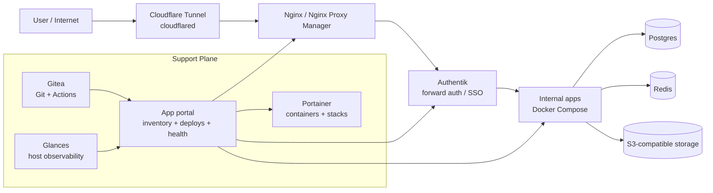
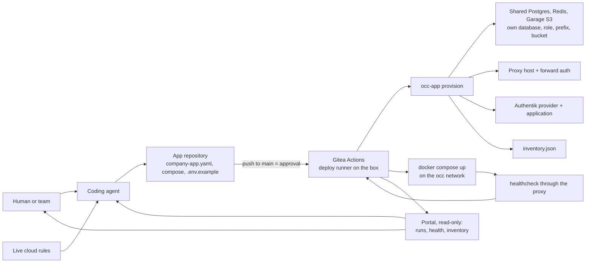

# Open Company Cloud

The company's cloud on one machine: an agent installs it, and an agent puts apps on the air in it.

One box runs what a small company needs around its internal apps: single sign-on, Git with push-to-deploy, shared Postgres and Redis, object storage, backups, ops tools and an optional operator agent. A coding agent can install the whole thing from this repository on a clean server, and then turn a one-sentence request into an app behind the company sign-in, with its own database, a health check and a backup, without production credentials.

> **Sibling project:** [Open Company OS](https://github.com/Estoca/open-company-os) is the people-and-work half: a protocol for giving every person a personal LLM agent, a private second brain, a shared tracker and a company compass. It runs on top of this cloud (its services are ordinary apps on it) and is adopted separately.

## Try It in 10 Minutes

On a Mac with Docker Desktop, directly (15 to 20 GiB free; no `sudo`):

```bash
git clone https://github.com/Estoca/open-company-cloud.git ~/src/open-company-cloud && cd ~/src/open-company-cloud
./install.sh --non-interactive --config bootstrap/config.example.yaml --install-dir ~/open-company-cloud
```

Or in a throwaway VM, on a Mac with [Homebrew](https://brew.sh) and no Docker (or skip the VM on any Ubuntu box with Docker):

```bash
brew install lima
limactl start --tty=false --name occ --cpus 2 --memory 4 --disk 30 template:docker
limactl shell occ
# inside the VM:
cd ~ && git clone https://github.com/Estoca/open-company-cloud.git && cd open-company-cloud
sudo install -d -o $(id -un) -g $(id -gn) /opt/open-company-cloud
./install.sh --non-interactive --config bootstrap/config.example.yaml
```

About a minute for the VM and five for the install. The install ends with seven day-zero steps, with the literal commands: open <http://portal.cloud.localhost> and sign in (the portal is a placeholder: it proves the SSO; to operate, Gitea + `occ-operator brief`), turn on MFA, copy the backup key off the machine, put a first app on the air with `scripts/occ-app.sh new <name> --owner <email> --push` (about 30 seconds later behind the same sign-in), and stop or remove a test install ([`docs/cleanup.md`](docs/cleanup.md)). Both paths, with the times measured: [`docs/try-it.md`](docs/try-it.md).

Or ask a coding agent. Below, Claude Code gets one sentence in Portuguese ("create an internal expense log app on our company cloud and put it on the air") and `ssh` to a box it has never seen; recordings and how they were made are in [`docs/demo/`](docs/demo/).


## What This Is

The thesis: the bundle is the product. Each piece exists elsewhere; what a small company lacks is all of them wired together on one machine, behind one sign-in, under one contract an agent can read.

- **The cloud.** One machine (a VPS, a server in the office, a VM on a laptop) runs the company's shared services: Authentik for SSO, Gitea with Actions for code and deploys, Postgres and Redis shared by every app, Garage for object storage, a reverse proxy that puts every app at `https://<slug>.<domain>`, a nightly backup with a lock, a timeout and a status, and admin-only ops tools.
- **An agent installs it.** `install.sh` is resumable and has a non-interactive mode, and [`AGENTS.md`](AGENTS.md) and [`docs/llm-bootstrap.md`](docs/llm-bootstrap.md) are written for a coding agent: on a clean VM, an agent with no prior context installed it from a layperson's request ([`docs/first-run.md`](docs/first-run.md#cold-install-run)).
- **An agent puts apps on the air in it.** An app is a repository with a `company-app.yaml`. A push to `main` is the approval: the deploy job gives the app its own database role, a Redis user, a bucket if it asks, a route behind the SSO and a health check, and nothing outside its own slug. The agent never holds production access.
- **Someone operates it.** The `agent` profile adds an operator agent with read-only access by default, a written [operator contract](docs/operator-contract.md) and [runbooks](docs/runbooks/), so "why is it down" has an answer on the box.

It is not a hosted platform. It is an installer, compose files, schemas, templates, runbooks and contracts that a company runs on its own machine and adapts.

## Why It Exists

Coding agents can produce internal apps faster than most teams can safely deploy them.

Without a shared platform, each app tends to grow its own deployment script, fixed port, environment variable pattern, auth behavior, and README. That works for one app. It becomes fragile at ten apps and risky at fifty.

Open Company Cloud creates a small cloud control plane around one machine:

- a standard ingress route;
- a default auth layer;
- local Git as the source of truth;
- shared runtime services;
- host and container visibility;
- a manifest for intent;
- a template for repeatability;
- checks for confidence;
- push to `main` for approval;
- an executor in the deploy job for runtime state;
- a portal for visibility;
- rules that agents can follow without needing production access.

## Single-Box Cloud

The central idea is that a single machine can provide the minimum useful shape of a company cloud.

That machine runs the control plane, the support plane, and the apps:

- code is hosted in the same environment through Gitea or another Git server;
- SSO is handled by Authentik or another identity gateway;
- ingress enters through a reverse proxy: on the box itself (`local`, tested), through Tailscale with the installation's own CA and split DNS (`private`, tested end to end: `https://<app>.<domain>` on the tailnet only), or through a Cloudflare tunnel (`public`, in the installer but not yet tested end to end);
- internal apps run as Docker Compose projects;
- shared databases and queues run locally when the app does not need managed services;
- Portainer, Glances, a web terminal (Wetty) and a file browser (FileBrowser) make the machine inspectable, for admins only behind the SSO (the `ops` profile);
- an optional operator agent answers "why is it down" in Slack or Telegram from a generated map of the box, read only by default, inside a written contract (the `agent` profile, [`docs/operator-contract.md`](docs/operator-contract.md));
- an app portal shows what should exist, what is running, and what changed (next on the roadmap; today a placeholder proves the SSO; to operate, Gitea + `occ-operator brief`);
- coding agents connect to the same machine and use the same contracts as humans.

This is not meant to replace AWS, Kubernetes, or a mature platform team. It is meant to cover the first, surprisingly large stage where a company needs internal software to be real, authenticated, observable, and repeatable, but does not yet need a distributed platform.

## Target Agent Experience

Two requests, each one sentence from a person who does not need to know the stack:

```text
"Set up this machine as our company cloud."
"Build an internal app for expense reports and put it on the air."
```

What a terminal-connected agent does with them, today:

1. Reads `AGENTS.md`, which routes it to `docs/agent-setup-contract.md` (what to ask, what never to do) and `docs/llm-bootstrap.md` (the commands, with success conditions).
2. **Install.** Asks for the install directory, ingress mode and domain, admin email, Gitea organization, backup destination and optional profiles; never for a password (the installer generates them). Shows `./install.sh --plan`, applies after a yes, and reports the URLs and the steps left to the human. Four to seven minutes on a clean box.
3. **App.** Runs `scripts/occ-app.sh new <slug>`, writes the app in the generated repository (shared Postgres and Redis through `DATABASE_URL` and `REDIS_URL`, the user from the SSO headers), pushes to `main`, and confirms the deploy run is green, `/health` answers 200 and `/` asks for the sign-in.
4. **Repair.** On a red run, reads the job log, fixes the app and pushes again.

The test of this is a cold run: an agent given only the repository and a one-line request in a layperson's words. Results in `docs/first-run.md`, "Cold agent run".

Not yet: the read-only portal with `GET /api/platform/status` for agents (a placeholder answers today), and tested `public` ingress. `private` ingress (Tailscale, own CA, split DNS, `https://<app>.<domain>` on the tailnet only) is tested end to end: `docs/install-design.md`, "Private ingress".

The cloud should also expose live app-building rules for day-to-day app creation. See `docs/app-rules-example.md` for a generalized example based on a real internal app platform rules file.

## Reference Open Source Stack

The default mental model is a small, self-hosted internal platform built from replaceable open source components.



The entry path is intentionally simple:

```text
cloudflared -> reverse proxy -> auth gateway -> app
```

The support plane keeps the environment operable:

- Gitea stores repositories and runs the deploy workflows on the box.
- Portainer gives visibility into containers, images, volumes, and stacks.
- Glances exposes host-level resource usage.
- The app portal shows app inventory, deploy runs, health checks, and backups (planned; a placeholder today).
- Postgres and Redis are shared by every app, each app with its own database, role and key prefix; S3-compatible object storage (Garage) is the optional `storage` profile, a bucket and key per app.
- Portainer and Glances, with a web terminal and a file browser, are the optional `ops` profile, for admins only.

Every box can be swapped. The cloud cares about the contracts between them: Git repositories, app manifests, reverse-proxy routes, auth headers, health checks, and deploy runs.

## Deployment Control Loop



The app repository says what should exist; the deploy job makes it exist and logs what it did; the portal reads the result. See [`docs/gitops-flow.md`](docs/gitops-flow.md).

## Core Idea

Every deployable app carries its operational contract in the repository:

```yaml
schema_version: 1

app:
  slug: example-app
  name: Example App
  owner_email: owner@example.com

runtime:
  type: docker-compose
  compose_file: docker-compose.yml
  service: app
  healthcheck:
    type: http
    path: /health
    expected_status: 200

deploy:
  enabled: true
  domain: example-app.internal.example.com
  port: auto
  env_file: .env
  env_example: .env.example

auth:
  required: true
  provider: forward-auth
  allowed_domains:
    - example.com
```

`occ-app provision` validates that contract on every push to `main` and refuses an app that breaks it, before anything changes.

## Operating Model

One path, from the first deploy to the hundredth:

1. `scripts/occ-app.sh new <slug>` creates the app from `templates/app` and its private repository in the Gitea organization.
2. A developer or a coding agent builds the app inside that contract (`docs/app-contract.md`).
3. A push to `main` is the approval. Who may push to `main` is set in Gitea: organization membership, team permissions, branch protection.
4. The deploy workflow runs on the box, on the deploy runner: it checks out the commit, runs `occ-app provision <slug>` (database and role on the shared Postgres, Redis ACL user and prefix, optional bucket, the app's env file, the proxy route with forward auth, the Authentik application, the inventory record), builds and starts the app on the occ network, and waits for its healthcheck through the proxy.
5. The run log in Gitea is the record; the portal reads it.

Nobody else acts between the push and the app on the air: the run log is the record and the push is the approval (`docs/gitops-flow.md`).

The deploy runner has the Docker socket and the install directory: a job there is root on the box, which is why it serves the organization's repositories only, and why write access in the organization should go to people you would trust with a shell on the box.

## Suggested Stack

The reference stack assumes:

- Git server: Gitea, GitHub Enterprise, GitLab, or GitHub;
- reverse proxy: Nginx Proxy Manager, Traefik, Caddy, or nginx;
- auth: Authentik, Authelia, OAuth2 Proxy, or another forward-auth provider;
- runtime: Docker Compose;
- portal: an internal, read-only app that shows apps, deploy runs, checks, health, and backups.

What `install.sh` sets up is one choice from each line: Gitea, Nginx Proxy Manager, Authentik, Docker Compose, Postgres and Redis, Garage for object storage, restic for backups. The others are where the contracts allow a swap, not something the installer does for you. The contract matters more than the exact vendor.

## What Makes This Different

This project is intentionally smaller than a full platform-as-a-service and stricter than a pile of scripts.

- It keeps the app contract in Git, close to the code.
- It lets companies run on simple infrastructure first.
- It treats AI agents as contributors that need rules, feedback, and boundaries.
- It separates validation from deployment.
- It keeps production credentials on the box (the install `.env` and each app's env file), not in chat, manifests, or app repos.
- It makes health and deploy state visible to humans and agents.

## Advantages

### For small teams

- Start with one host and Docker Compose instead of a full Kubernetes platform.
- Get a repeatable path for internal apps without building a large platform team.
- Keep operational decisions visible in Git.

### For platform teams

- Standardize app metadata, ownership, auth, health, and deploy behavior.
- Make drift visible by comparing Git intent with runtime reality.
- Introduce stronger backends later without changing the app contract.

### For coding agents

- Give agents a clear contract instead of tribal knowledge.
- Let agents fix validation failures from actionable feedback.
- Avoid giving agents broad production access.
- Make generated apps easier to review because they follow the same shape.

### For security and operations

- Pull requests run checks on the CI runner, without the Docker socket or deploy credentials.
- New apps require auth by default.
- Port allocation can be centralized.
- Secrets stay out of manifests and `.env.example`.
- Destructive actions are outside the default automation path.

## Lessons Behind The Architecture

This project grew from a practical pattern: agent-built apps become useful quickly, but they need a boring operational path to stay safe.

The key lessons:

- A template is not enough. Teams need a contract, checks, and a deploy path.
- A manifest beats scattered README instructions because it can be validated.
- The approval belongs where review already happens: the app's own `main`.
- Agents should prepare and repair deployment artifacts; the deploy itself is a script anyone can read, not an agent improvising on the box.
- Health checks need to be part of the contract, not an afterthought.
- Auth should be the default for internal apps, with explicit exceptions.
- Automatic port allocation prevents slow, hidden conflicts.
- The portal should observe and compare state; Git should remain the source of app intent.
- The simplest workable runtime is often the right starting point, as long as the contract can outlive it.

## Repository Layout

```text
AGENTS.md              Agent instructions for terminal-connected LLMs
docs/                  Architecture, install design, GitOps flow, app contract, backup, security
docs/try-it.md         The ten-minute path for a person; docs/demo/ has the recordings
docs/first-run.md      What the install automates, what it leaves to you, and every test record
docs/llm-bootstrap.md, docs/agent-setup-contract.md   The agent path
docs/operator-contract.md, docs/runbooks/             The operator agent (agent profile)
schemas/               JSON schema for company-app.yaml
templates/app/         The app template occ-app new copies: runnable app, manifest, deploy workflow
examples/minimal-web-app/  The placeholder portal
docker/                compose.yml (core with the Actions runners; profiles storage, ops, backup, agent,
                       cloudflared, tailscale), .env.example, backup/ and deployer/ images
install.sh             One-command installer: plan, apply, resume, status
scripts/first-run.sh   First access: Gitea admin and org, Authentik OIDC, portal route
scripts/occ-app.sh new, provision, checkout, wait, list: the app loop (docs/gitops-flow.md)
scripts/occ-backup.sh run, verify, status: the nightly backup (docs/backup.md)
scripts/smoke-tests.sh The checks that decide "installed"
scripts/sso-login-check.sh  Walks the sign-in with curl, the way a browser would
scripts/occ-operator.sh brief: the generated map an operator reads first (docs/operator-contract.md)
scripts/lib/, scripts/tests/  Helpers (Authentik and proxy, Garage, env files, state) and their tests
bootstrap/             config.example.yaml and state.example.json for the installer
packages/cli/          Placeholder for validation and workflow tooling
```

## Status

Usable on one box, with `local` ingress. Proven on clean VMs and recorded in [`docs/first-run.md`](docs/first-run.md): `install.sh` brings up the core cloud with 16 smoke tests (19 with the `storage` and `ops` profiles), `occ-app` takes an app from `new` to the air behind the sign-in by a push to `main`, and a coding agent that has never seen the cloud installs it from a layperson's request (about 8 minutes, no password in the conversation) and puts a new app on the air (about 2 minutes). `private` ingress (Tailscale) is tested end to end too, with a sign-in from another device on the tailnet. Not there yet: the real portal (a placeholder answers), `public` ingress tested end to end, the off-site backup copy and the monthly restore rehearsal.

## Roadmap

Done:

- PR 1: install design (profiles, ingress matrix, stage model, first-run, backup minimum).
- PR 2: `install.sh`, the core cloud on one box (proxy, Authentik, Gitea on the shared Postgres, shared Postgres and Redis), first-run automation, smoke tests.
- PR 3: backup job (restic sidecar, lock, hard timeout, status file).
- PR 4: the app loop: `occ-app new`, deploy by push to `main` on Gitea Actions, the Actions runners in core.
- PR 5: the agent path (`AGENTS.md`, `docs/llm-bootstrap.md`, `docs/agent-setup-contract.md`) rewritten for the loop above and tested with a cold agent run.
- PR 6: the `ops` profile: Portainer, Glances, a web terminal and a file browser, for admins only behind the SSO.
- PR 7: the cold install run: an agent installs the cloud from zero on a clean box from a layperson's request.
- PR 8: the `storage` profile on Garage (the earlier S3 server's images were no longer downloadable), a bucket and key per app.
- PR 9: the `agent` profile: the operator contract ([`docs/operator-contract.md`](docs/operator-contract.md)), runbooks ([`docs/runbooks/`](docs/runbooks/)), the generated brief (`scripts/occ-operator.sh brief`) and OpenClaw as the reference agent, read only by default.
- PR 10: try it in 10 minutes ([`docs/try-it.md`](docs/try-it.md)), the demo recordings and the announcement drafts.
- PR 11: `private` ingress: Tailscale serve, the installation's own name-constrained CA, split DNS.
- PR 12: the rename to Open Company Cloud (`occ-*` commands, `OCC_*` variables); old names load for one version.
- PR 13: onboarding after the install: the day-zero handoff, `--plan` as a dry run, stop, start and remove.
- PR 14: the operator agent in conversation (Telegram), with a memory limit and the writes it can use.

Next:

- The real portal, ported from the internal portal already running in the reference installation: read-only inventory, deploy runs, health, backups, the people who can sign in and their groups (read from Authentik), and `GET /api/platform/status` for agents.
- `occ doctor`: one command that checks the box the way the smoke tests do (routes and DNS, TLS, the sign-in, disk, containers and their health checks, the age of the last backup) and answers in plain text for a person and with `--json` for an agent or the operator. It works with or without the `agent` profile.
- `public` (tunnel) ingress, tested end to end.
- The off-site backup copy and the monthly restore rehearsal (`docs/backup.md`).
- **Every app is born agent-ready.** An `mcp:` section in `company-app.yaml` (provider name, tools, scopes, owner), a minimal MCP endpoint in the app template (one discovery tool and one read tool), and the deploy recording the provider in the inventory. `occ-app new` and the agent path produce it by default; a company can make it mandatory.
- **The cloud's own MCP.** One gateway per company at `mcp.<BASE_DOMAIN>`, behind the SSO, that knows which person is calling: the platform's tools read only (status, apps, deploy runs, backup age, `doctor`) and a route to each app's provider by audience and scope, with a token per person or team. Apps never expose MCP on their own; the gateway does. This is the endpoint the [Open Company OS](https://github.com/Estoca/open-company-os) assumes exists. The reference installation runs a separate internal MCP service today; it becomes the reference implementation and moves inside.

Later:

- Restoring one app from a snapshot (`occ-app restore <slug>`), without restoring the whole box. The dumps are already per database.

## Safety Principles

- Git is the source of truth for app intent.
- Pull requests validate without production secrets.
- Real deployment happens only on a push to `main`, the explicit approval signal.
- App manifests never contain secret values.
- New apps use automatic port allocation by default.
- Internal apps should require authentication by default.
- The cloud never deletes databases, volumes, repositories, stacks, or proxy routes automatically.
- Runtime changes should be previewable before they are applied.
- Agent-facing errors should explain the next fix, not just the failed check.

## Getting Started

**Asking a coding agent to install it.** Give the agent this repository and `ssh` access to the box, and ask in your own words ("set up our company cloud on this server"). It reads [`AGENTS.md`](AGENTS.md), copies the repository to the box, asks you a handful of plain questions (your email, the company name, who reaches the apps, backups), shows the plan and installs after your yes. What the box must have before that, none of which the agent installs:

- Linux (tested: Ubuntu 26.04), 2 CPUs, 4 GiB of memory (6 GiB with the operator agent), 10 GiB free disk;
- Docker Engine usable by the `ssh` user without `sudo` (rootless, or the user in the `docker` group) and Docker Compose v2;
- `git`, `curl`, `python3`; `sshd` for the web terminal of the admin tools;
- `sudo` for one command if the install directory is under `/opt` (or answer with a folder the user owns).

**Trying it yourself.** [`docs/try-it.md`](docs/try-it.md): on a Mac with Docker Desktop or in a VM on your laptop, one install command, a first app on the air, about 8 minutes. Adding the next person: [`docs/first-user.md`](docs/first-user.md). Stopping or removing it: [`docs/cleanup.md`](docs/cleanup.md).

Start with the docs:

- `docs/try-it.md`
- `docs/architecture.md`
- `docs/quickstart.md`
- `docs/app-rules-example.md`
- `docs/agent-setup-contract.md`
- `docs/llm-bootstrap.md`
- `docs/app-contract.md`
- `docs/gitops-flow.md`
- `docs/security.md`

Then inspect:

- `templates/app/`
- `examples/minimal-web-app/`

## Install

One command, a few questions, the core cloud up and verified:

```bash
./install.sh
```

Same path for an agent or CI, with the answers in a file:

```bash
./install.sh --non-interactive --config bootstrap/config.example.yaml
```

`--plan` prints what would happen and creates nothing (no directory, no `state.json`); `--apply --from <stage>` resumes. After the install:

```bash
./install.sh handoff     # the seven day-zero steps again
./install.sh status      # short: state, URLs, service health, backup age, apps and owners
./install.sh status --verbose   # every stage and the full operator brief (scripts/occ-operator.sh brief)
./install.sh stop        # stop the cloud and its apps, data kept (start: ./install.sh start)
./install.sh remove      # remove a test install; asks for the project name (docs/cleanup.md)
```
 Re-running on an installed box changes nothing. Every stage, the generated `.env` (0600) and the smoke tests are described in `docs/install-design.md`, `docs/first-run.md` and `docs/smoke-tests.md`; the agent path is in `docs/llm-bootstrap.md`.

### Backup

Part of the install, on by default. A small `backup` container runs `scripts/occ-backup.sh` on `backup.schedule` (02:00 UTC by default): every Postgres database of the shared instance and of Authentik's, streamed by `pg_dump` into an encrypted restic repository, plus the Gitea, proxy, Authentik and Garage (storage profile) volumes and the install directory. Retention is 7 daily, 4 weekly, 12 monthly. A lock and a hard timeout keep a hung run from blocking the next night; it is killed and recorded as failed. Each run writes `reports/latest-status.json`, which the portal reads.

```bash
export OCC_BACKUP_DESTINATION=/mnt/backup-disk/occ   # or answer the installer's question, or backup.destination in the config
scripts/occ-backup.sh --install-dir /opt/open-company-cloud run
scripts/occ-backup.sh --install-dir /opt/open-company-cloud verify --latest
scripts/occ-backup.sh --install-dir /opt/open-company-cloud status
```

Keep a copy of `BACKUP_ENCRYPTION_KEY` from `.env` off the box: the repository cannot be read without it. The off-site copy and the monthly restore rehearsal are not built yet. Details and restore steps: `docs/backup.md`. App databases live on the shared Postgres, so they are in the nightly dump with everything else.

## Deploy an app

On the box (the Actions runners are part of every install):

```bash
scripts/occ-app.sh new expense-report --owner maria@example.com --install-dir /opt/open-company-cloud
cd expense-report
git push -u origin main
```

The push runs `.gitea/workflows/deploy.yml` on the box: the app gets its own database and role on the shared Postgres, a Redis user limited to its key prefix, an env file at `<install-dir>/apps/expense-report/.env` (0600), the route `expense-report.<BASE_DOMAIN>` behind the SSO and a line in `inventory.json`; then it is built, started on the occ network and checked at `/health`. Every later push redeploys it, keeping its passwords. The flow, the runners and the trust they need: `docs/gitops-flow.md`. The contract the app keeps: `docs/app-contract.md`.

`scripts/bootstrap.mjs` remains for cloning the platform repositories of a manifest (`bootstrap/repos.example.json`); it no longer starts services.

## Name

This project was called **Open Company App Harness** (repository `open-company-app-harness`) until 2026-10-20. It started as a harness around coding agents and grew into the company's cloud on one machine, so it was renamed to match its sibling, Open Company OS. Commands, variables and defaults changed with it (`harness-app` → `occ-app`, `HARNESS_*` → `OCC_*`); what still reads the old names, and for how long, is in [`docs/install-design.md`](docs/install-design.md#renamed-from-open-company-app-harness).
