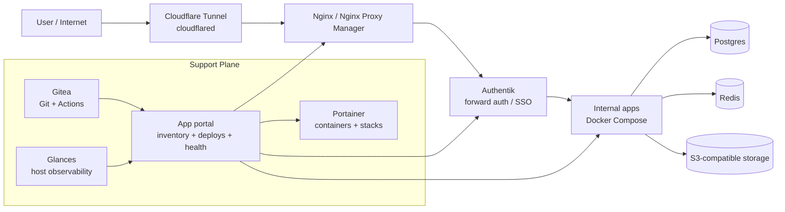
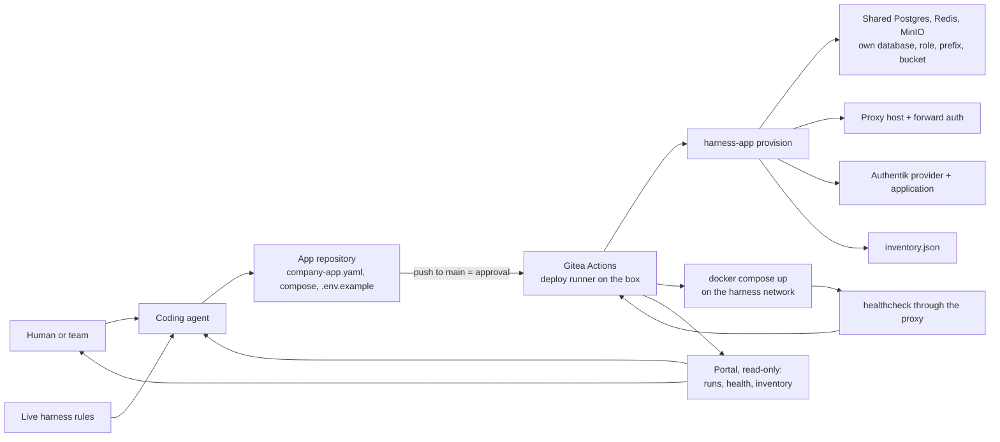

# Open Company App Harness

A lightweight, open source blueprint for running a small internal cloud on a single machine: Git, SSO, reverse proxy, databases, observability, app deployment, and coding-agent workflows.

The project is designed for teams that want one server to behave like a practical company cloud: a place where code lives, internal apps run, users authenticate, services are observed, and coding agents can safely help operate the environment.

Internal tools are often small enough to build quickly but important enough to need Git, SSO, databases, health checks, backups, auditability, and a clear deployment path. AI coding agents make the building faster. This harness focuses on the system around them: the single-box cloud that turns generated apps into operated software.

> **Sibling project:** [Open Company OS](https://github.com/Estoca/open-company-os) is the people-and-work half: a protocol for giving every person a personal LLM agent, a private second brain, a shared tracker and a company compass. It runs on top of this harness (its services are ordinary harness apps) and is adopted separately.

## What This Is

Open Company App Harness is a reference architecture and starter kit for a self-hosted internal platform that includes:

- an ingress path from the public internet to private apps;
- SSO and access policy for internal tools;
- Git hosting and automation for app repositories;
- Docker Compose as the default runtime;
- shared services such as Postgres, Redis, and object storage;
- container and host observability;
- an app portal for inventory, deploys, health, and drift;
- an operational contract for each app with `company-app.yaml`;
- push-to-deploy: a push to `main` is the approval, and Gitea Actions on the box provisions and starts the app behind the SSO;
- coding-agent instructions that let agents build and repair apps without broad production access.
- a live app-building rules pattern that tells agents how this company wants apps created.

It is not a hosted platform. It is a set of conventions, schemas, templates, compose files, runbooks, and implementation building blocks that a company can adapt to its own infrastructure.

## Why It Exists

Coding agents can produce internal apps faster than most teams can safely deploy them.

Without a harness, each app tends to grow its own deployment script, fixed port, environment variable pattern, auth behavior, and README. That works for one app. It becomes fragile at ten apps and risky at fifty.

Open Company App Harness creates a small cloud control plane around one machine:

- a standard ingress route;
- a default auth layer;
- local Git as the source of truth;
- shared runtime services;
- host and container visibility;
- a manifest for intent;
- a template for repeatability;
- checks for confidence;
- push to `main` for approval;
- an executor in the deploy job for runtime state;
- a portal for visibility;
- rules that agents can follow without needing production access.

## Single-Box Cloud

The central idea is that a single machine can provide the minimum useful shape of a company cloud.

That machine runs the control plane, the support plane, and the apps:

- code is hosted in the same environment through Gitea or another Git server;
- SSO is handled by Authentik or another identity gateway;
- public ingress enters through a tunnel and reverse proxy;
- internal apps run as Docker Compose projects;
- shared databases and queues run locally when the app does not need managed services;
- Portainer and Glances make the machine inspectable;
- an app portal records what should exist, what is running, and what changed;
- coding agents connect to the same machine and use the same contracts as humans.

This is not meant to replace AWS, Kubernetes, or a mature platform team. It is meant to cover the first, surprisingly large stage where a company needs internal software to be real, authenticated, observable, and repeatable, but does not yet need a distributed platform.

## Target Agent Experience

The intended setup experience is:

```text
User sends the GitHub repository URL to a terminal-connected LLM.
The LLM reads the repo, explains the stack, asks for local choices, generates a plan, applies approved steps, starts approved services, verifies health, and leaves the box ready for new app deploys.
```

The LLM should explain what will be installed before changing the machine:

- tunnel and ingress;
- reverse proxy;
- SSO/auth gateway;
- Git server and automation;
- Docker Compose runtime;
- shared Postgres, Redis, and storage options;
- Portainer and Glances;
- app portal;
- templates, schemas, and the push-to-deploy flow.

The LLM should ask for values such as admin email, admin username, admin password or permission to generate one, base domain, install directory, tunnel provider, and whether it may start Docker services or create public routes.

See `docs/agent-setup-contract.md` for the full agent-readable contract, and `docs/install-design.md` for the design of the one-command installer that contract drives (profiles, ingress matrix, stage model, first-run automation, backup minimum, and what the first production box taught us).

The harness should also expose live app-building rules for day-to-day app creation. See `docs/app-rules-example.md` for a generalized example based on a real internal app platform rules file.

## Reference Open Source Stack

The default mental model is a small, self-hosted internal platform built from replaceable open source components.



The entry path is intentionally simple:

```text
cloudflared -> reverse proxy -> auth gateway -> app
```

The support plane keeps the environment operable:

- Gitea stores repositories and runs the deploy workflows on the box.
- Portainer gives visibility into containers, images, volumes, and stacks.
- Glances exposes host-level resource usage.
- The app portal records app inventory, deploy history, health checks, and drift.
- Shared services such as Postgres, Redis, and object storage are optional but standardized.

Every box can be swapped. The harness cares about the contracts between them: Git repositories, app manifests, reverse-proxy routes, auth headers, health checks, and deploy events.

## Deployment Control Loop



The app repository says what should exist; the deploy job makes it exist and logs what it did; the portal reads the result. See [`docs/gitops-flow.md`](docs/gitops-flow.md).

## Core Idea

Every deployable app carries its operational contract in the repository:

```yaml
schema_version: 1

app:
  slug: example-app
  name: Example App
  owner_email: owner@example.com

runtime:
  type: docker-compose
  compose_file: docker-compose.yml
  service: app
  healthcheck:
    type: http
    path: /health
    expected_status: 200

deploy:
  enabled: true
  domain: example-app.internal.example.com
  port: auto
  env_file: .env
  env_example: .env.example

auth:
  required: true
  provider: forward-auth
  allowed_domains:
    - example.com
```

`harness-app provision` validates that contract on every push to `main` and refuses an app that breaks it, before anything changes.

## Operating Model

One path, from the first deploy to the hundredth:

1. `scripts/harness-app.sh new <slug>` creates the app from `templates/app` and its private repository in the Gitea organization.
2. A developer or a coding agent builds the app inside that contract (`docs/app-contract.md`).
3. A push to `main` is the approval. Who may push to `main` is set in Gitea: organization membership, team permissions, branch protection.
4. The deploy workflow runs on the box, on the deploy runner: it checks out the commit, runs `harness-app provision <slug>` (database and role on the shared Postgres, Redis ACL user and prefix, optional bucket, the app's env file, the proxy route with forward auth, the Authentik application, the inventory record), builds and starts the app on the harness network, and waits for its healthcheck through the proxy.
5. The run log in Gitea is the record; the portal reads it.

There is no deploy request and no operator agent in the loop. The first box had both and retired them: the steps an operator repeated by hand became the executor, and the approval moved to where review already happened, the app's own `main` (`docs/gitops-flow.md`, "Why there is no deploy request").

The deploy runner has the Docker socket and the install directory: a job there is root on the box, which is why it serves the organization's repositories only, and why write access in the organization should go to people you would trust with a shell on the box.

## Suggested Stack

The reference stack assumes:

- Git server: Gitea, GitHub Enterprise, GitLab, or GitHub;
- reverse proxy: Nginx Proxy Manager, Traefik, Caddy, or nginx;
- auth: Authentik, Authelia, OAuth2 Proxy, or another forward-auth provider;
- runtime: Docker Compose;
- portal: an internal, read-only app that shows apps, deploy runs, checks, health, and backups.

These tools are intentionally replaceable. The contract matters more than the exact vendor.

## What Makes This Different

This project is intentionally smaller than a full platform-as-a-service and stricter than a pile of scripts.

- It keeps the app contract in Git, close to the code.
- It lets companies run on simple infrastructure first.
- It treats AI agents as contributors that need rules, feedback, and boundaries.
- It separates validation from deployment.
- It keeps production credentials on the box (the install `.env` and each app's env file), not in chat, manifests, or app repos.
- It makes health and deploy state visible to humans and agents.

## Advantages

### For small teams

- Start with one host and Docker Compose instead of a full Kubernetes platform.
- Get a repeatable path for internal apps without building a large platform team.
- Keep operational decisions visible in Git.

### For platform teams

- Standardize app metadata, ownership, auth, health, and deploy behavior.
- Make drift visible by comparing Git intent with runtime reality.
- Introduce stronger backends later without changing the app contract.

### For coding agents

- Give agents a clear contract instead of tribal knowledge.
- Let agents fix validation failures from actionable feedback.
- Avoid giving agents broad production access.
- Make generated apps easier to review because they follow the same shape.

### For security and operations

- Pull requests run checks on the CI runner, without the Docker socket or deploy credentials.
- New apps require auth by default.
- Port allocation can be centralized.
- Secrets stay out of manifests and `.env.example`.
- Destructive actions are outside the default automation path.

## Lessons Behind The Architecture

This harness grew from a practical pattern: agent-built apps become useful quickly, but they need a boring operational path to stay safe.

The key lessons:

- A template is not enough. Teams need a contract, checks, and a deploy path.
- A manifest beats scattered README instructions because it can be validated.
- The approval belongs where review already happens: the app's own `main`. A separate deploy-request repository was a second approval of the same change.
- Agents should prepare and repair deployment artifacts; the deploy itself is a script anyone can read, not an agent improvising on the box.
- Health checks need to be part of the contract, not an afterthought.
- Auth should be the default for internal apps, with explicit exceptions.
- Automatic port allocation prevents slow, hidden conflicts.
- The portal should observe and compare state; Git should remain the source of app intent.
- The simplest workable runtime is often the right starting point, as long as the contract can outlive it.

## Repository Layout

```text
AGENTS.md              Agent instructions for terminal-connected LLMs
docs/                  Architecture, quickstart, GitOps flow, security
docs/agent-setup-contract.md
docs/app-rules-example.md
schemas/               JSON schema for company-app.yaml
templates/app/         The app template harness-app new copies: runnable app, manifest, deploy workflow
examples/minimal-web-app/  The placeholder portal
docker/                compose.yml (profiles core, storage, ci, ops, backup), .env.example, backup/ and deployer/ images
install.sh             One-command installer: plan, apply, resume, status
scripts/first-run.sh   First access: Gitea admin and org, Authentik OIDC, portal route
scripts/harness-app.sh new, provision, checkout, wait: the app loop (docs/gitops-flow.md)
scripts/smoke-tests.sh The checks that decide "installed"
bootstrap/             config.example.yaml and state.example.json for the installer
packages/cli/          Placeholder for validation and workflow tooling
```

## Status

Early extraction. `install.sh` brings up the core cloud on one box and `harness-app` takes an app from `new` to the air by push to `main`; both pass on a clean VM ([`docs/first-run.md`](docs/first-run.md)). The portal is still a placeholder.

## Safety Principles

- Git is the source of truth for app intent.
- Pull requests validate without production secrets.
- Real deployment happens only on a push to `main`, the explicit approval signal.
- App manifests never contain secret values.
- New apps use automatic port allocation by default.
- Internal apps should require authentication by default.
- The harness never deletes databases, volumes, repositories, stacks, or proxy routes automatically.
- Runtime changes should be previewable before they are applied.
- Agent-facing errors should explain the next fix, not just the failed check.

## Getting Started

Start with the docs:

- `docs/architecture.md`
- `docs/quickstart.md`
- `docs/app-rules-example.md`
- `docs/agent-setup-contract.md`
- `docs/llm-bootstrap.md`
- `docs/app-contract.md`
- `docs/gitops-flow.md`
- `docs/security.md`

Then inspect:

- `templates/app/`
- `examples/minimal-web-app/`

## Install

One command, a few questions, the core cloud up and verified:

```bash
./install.sh
```

Same path for an agent or CI, with the answers in a file:

```bash
./install.sh --non-interactive --config bootstrap/config.example.yaml
```

`--plan` prints what would happen and changes nothing; `--apply --from <stage>` resumes; `status` reports the state file. Re-running on an installed box changes nothing. Every stage, the generated `.env` (0600) and the smoke tests are described in `docs/install-design.md`, `docs/first-run.md` and `docs/smoke-tests.md`; the agent path is in `docs/llm-bootstrap.md`.

### Backup

Part of the install, on by default. A small `backup` container runs `scripts/harness-backup.sh` on `backup.schedule` (02:00 UTC by default): every Postgres database of the shared instance and of Authentik's, streamed by `pg_dump` into an encrypted restic repository, plus the Gitea, proxy, Authentik and MinIO volumes and the install directory. Retention is 7 daily, 4 weekly, 12 monthly. A lock and a hard timeout keep a hung run from blocking the next night; it is killed and recorded as failed. Each run writes `reports/latest-status.json`, which the portal reads.

```bash
export HARNESS_BACKUP_DESTINATION=/mnt/backup-disk/harness   # optional; default <install-dir>/backups
scripts/harness-backup.sh --install-dir /opt/open-company-harness run
scripts/harness-backup.sh --install-dir /opt/open-company-harness verify --latest
scripts/harness-backup.sh --install-dir /opt/open-company-harness status
```

Keep a copy of `BACKUP_ENCRYPTION_KEY` from `.env` off the box: the repository cannot be read without it. The off-site copy and the monthly restore rehearsal are not built yet. Details and restore steps: `docs/backup.md`. App databases live on the shared Postgres, so they are in the nightly dump with everything else.

## Deploy an app

With the `ci` profile on (`install.profile.ci: true`), on the box:

```bash
scripts/harness-app.sh new expense-report --owner maria@example.com --install-dir /opt/open-company-harness
cd expense-report
git push -u origin main
```

The push runs `.gitea/workflows/deploy.yml` on the box: the app gets its own database and role on the shared Postgres, a Redis user limited to its key prefix, an env file at `<install-dir>/apps/expense-report/.env` (0600), the route `expense-report.<BASE_DOMAIN>` behind the SSO and a line in `inventory.json`; then it is built, started on the harness network and checked at `/health`. Every later push redeploys it, keeping its passwords. The flow, the runners and the trust they need: `docs/gitops-flow.md`. The contract the app keeps: `docs/app-contract.md`.

`scripts/bootstrap.mjs` remains for cloning the platform repositories of a manifest (`bootstrap/repos.example.json`); it no longer starts services.
