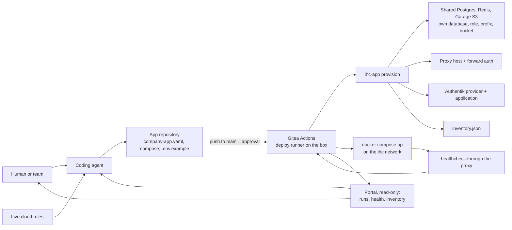

# The Deploy Loop

The app repository says what should exist; the deploy job makes it exist and logs what it did; the portal reads the result.

## Deployment control loop



The step by step, the runners and the trust they need: [`gitops-flow.md`](gitops-flow.md).

## Core idea

Every deployable app carries its operational contract in the repository:

```yaml
schema_version: 1

app:
  slug: example-app
  name: Example App
  owner_email: owner@example.com

runtime:
  type: docker-compose
  compose_file: docker-compose.yml
  service: app
  healthcheck:
    type: http
    path: /health
    expected_status: 200

deploy:
  enabled: true
  domain: example-app.internal.example.com
  port: auto
  env_file: .env
  env_example: .env.example

auth:
  required: true
  provider: forward-auth
  allowed_domains:
    - example.com
```

`ihc-app provision` validates that contract on every push to `main` and refuses an app that breaks it, before anything changes. The full contract, with the variables an app receives and its MCP section: [`app-contract.md`](app-contract.md).

## Operating model

One path, from the first deploy to the hundredth:

1. `scripts/ihc-app.sh new <slug>` creates the app from `templates/app` and its private repository in the Gitea organization.
2. A developer or a coding agent builds the app inside that contract ([`app-contract.md`](app-contract.md)).
3. A push to `main` is the approval. Who may push to `main` is set in Gitea: organization membership, team permissions, branch protection.
4. The deploy workflow runs on the box, on the deploy runner: it checks out the commit, runs `ihc-app provision <slug>` (database and role on the shared Postgres, Redis ACL user and prefix, optional bucket, the app's env file, the proxy route with forward auth, the Authentik application, the inventory record), builds and starts the app on the ihc network, and waits for its healthcheck through the proxy.
5. The run log in Gitea is the record; the portal reads it.

Nobody else acts between the push and the app on the air: the run log is the record and the push is the approval ([`gitops-flow.md`](gitops-flow.md)).

The deploy runner has the Docker socket and the install directory: a job there is root on the box, which is why it serves the organization's repositories only, and why write access in the organization should go to people you would trust with a shell on the box.
