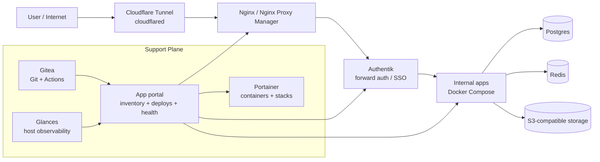

# One Machine, One Cloud

InHouseCloud: the company's own cloud, installed and operated with one command. Open source.

One box runs what a small company needs around its internal apps: single sign-on, Git with push-to-deploy, shared Postgres and Redis, object storage, backups, ops tools and an optional operator agent. A coding agent can install the whole thing from this repository on a clean server, and then turn a one-sentence request into an app behind the company sign-in, with its own database, a health check and a backup, without production credentials.

> **Sibling project:** [InHouseOS](https://github.com/Estoca/inhouseos) is the people-and-work half: a protocol for giving every person a personal LLM agent, a private second brain, a shared tracker and a company compass. It runs on top of this cloud (its services are ordinary apps on it) and is adopted separately.

## What this is

The thesis: the bundle is the product. Each piece exists elsewhere; what a small company lacks is all of them wired together on one machine, behind one sign-in, under one contract an agent can read.

- **The cloud.** One machine (a server in the office, a Mac with Docker Desktop, a VM on a laptop, a VPS on a private network) runs the company's shared services: Authentik for SSO, Gitea with Actions for code and deploys, Postgres and Redis shared by every app, Garage for object storage, a reverse proxy that puts every app at `https://<slug>.<domain>`, a nightly backup with a lock, a timeout and a status, and admin-only ops tools.
- **An agent installs it.** `install.sh` is resumable and has a non-interactive mode, and [`AGENTS.md`](../AGENTS.md) and [`llm-bootstrap.md`](llm-bootstrap.md) are written for a coding agent: on a clean VM, an agent with no prior context installed it from a layperson's request ([`first-run.md`](first-run.md#cold-install-run)).
- **An agent puts apps on the air in it.** An app is a repository with a `company-app.yaml`. A push to `main` is the approval: the deploy job gives the app its own database role, a Redis user, a bucket if it asks, a route behind the SSO and a health check, and nothing outside its own slug. The agent never holds production access.
- **Someone operates it.** The `agent` profile adds an operator agent with read-only access by default, a written [operator contract](operator-contract.md) and [runbooks](runbooks/), so "why is it down" has an answer on the box.

It is not a hosted platform. It is an installer, compose files, schemas, templates, runbooks and contracts that a company runs on its own machine and adapts.

## Single-box cloud

The central idea is that a single machine can provide the minimum useful shape of a company cloud.

That machine runs the control plane, the support plane, and the apps:

- code is hosted in the same environment through Gitea or another Git server;
- SSO is handled by Authentik or another identity gateway;
- ingress enters through a reverse proxy: on the box itself (`local`, tested), or through Tailscale with the installation's own CA and split DNS (`private`, tested end to end: `https://<app>.<domain>` on the tailnet only); a Cloudflare tunnel or public DNS (`public`) is a later step, already in the installer and documented once it has its own run;
- internal apps run as Docker Compose projects;
- shared databases and queues run locally when the app does not need managed services;
- Portainer, Glances, a web terminal (Wetty) and a file browser (FileBrowser) make the machine inspectable, for admins only behind the SSO (the `ops` profile);
- an optional operator agent answers "why is it down" in Slack or Telegram from a generated map of the box, read only by default, inside a written contract (the `agent` profile, [`operator-contract.md`](operator-contract.md));
- an app portal shows what should exist, what is running, and what changed: the catalog from the inventory, each app's health and SSO, its deploys, the platform's services and the backup, and Authentik's people and groups for admins (read only; to change something, Gitea + `ihc-operator brief`);
- an MCP gateway at `mcp.<domain>` lets a person's AI client use the platform's read-only tools and every app's tools, signed in as that person ([`mcp-gateway.md`](mcp-gateway.md));
- coding agents connect to the same machine and use the same contracts as humans.

This is not meant to replace AWS, Kubernetes, or a mature platform team. It is meant to cover the first, surprisingly large stage where a company needs internal software to be real, authenticated, observable, and repeatable, but does not yet need a distributed platform.

## Reference open source stack

The default mental model is a small, self-hosted internal platform built from replaceable open source components.



The entry path is intentionally simple:

```text
cloudflared -> reverse proxy -> auth gateway -> app
```

(With `local` or `private` ingress, the first hop is the box itself or the tailnet instead of `cloudflared`.)

The support plane keeps the environment operable:

- Gitea stores repositories and runs the deploy workflows on the box.
- Portainer gives visibility into containers, images, volumes, and stacks.
- Glances exposes host-level resource usage.
- The app portal shows app inventory, deploy runs, health checks, SSO, and backups (`portal/`, read only).
- Postgres and Redis are shared by every app, each app with its own database, role and key prefix; S3-compatible object storage (Garage) is the optional `storage` profile, a bucket and key per app.
- Portainer and Glances, with a web terminal and a file browser, are the optional `ops` profile, for admins only.

Every box can be swapped. The cloud cares about the contracts between them: Git repositories, app manifests, reverse-proxy routes, auth headers, health checks, and deploy runs.

## Suggested stack

The reference stack assumes:

- Git server: Gitea, GitHub Enterprise, GitLab, or GitHub;
- reverse proxy: Nginx Proxy Manager, Traefik, Caddy, or nginx;
- auth: Authentik, Authelia, OAuth2 Proxy, or another forward-auth provider;
- runtime: Docker Compose;
- portal: an internal, read-only app that shows apps, deploy runs, checks, health, and backups.

What `install.sh` sets up is one choice from each line: Gitea, Nginx Proxy Manager, Authentik, Docker Compose, Postgres and Redis, Garage for object storage, restic for backups. The others are where the contracts allow a swap, not something the installer does for you. The contract matters more than the exact vendor.

The components one by one, with the topology: [architecture](architecture.md).
